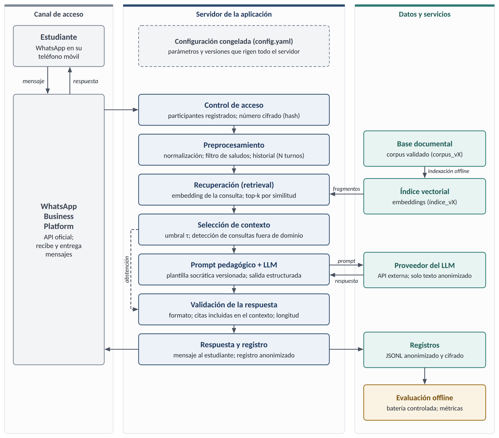
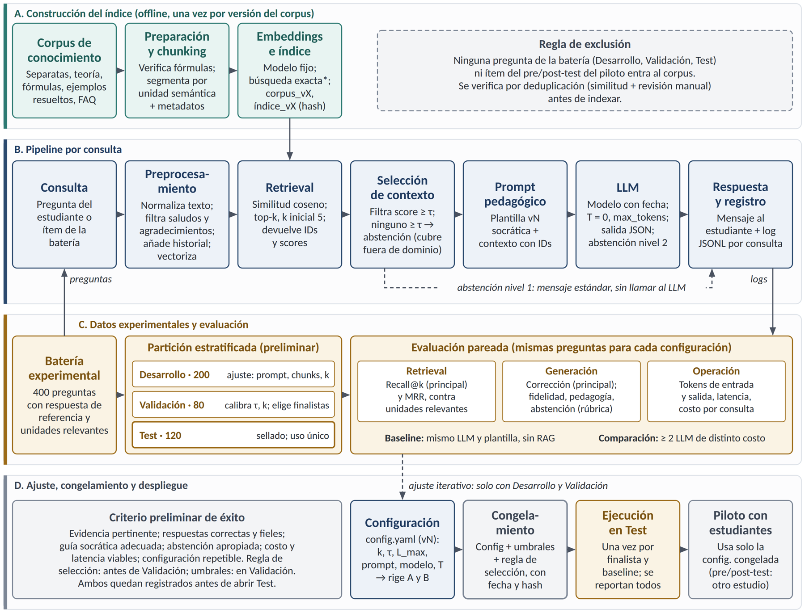
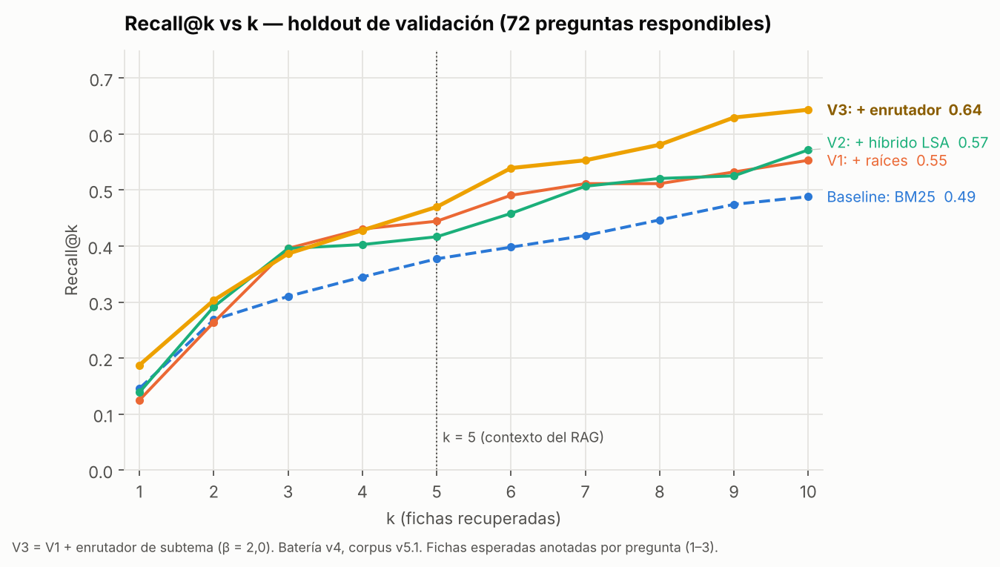

# Chatbot educativo de cinemática basado en IA generativa y RAG

**Desarrollo y evaluación de un chatbot educativo basado en IA generativa y RAG para reforzar el aprendizaje de cinemática preuniversitaria en una academia de Chachapoyas**

| | |
|---|---|
| **Autor** | Elmer Dante Rojas Zuta |
| **Programa** | Maestría en Inteligencia Artificial — Universidad Nacional de Ingeniería (UNI) |
| **Curso** | Proyecto de Investigación II |
| **Docente** | Glen Dario Rodriguez Rafael |
| **Tipo de tesis** | LLM + RAG (Retrieval-Augmented Generation) |
| **Estado** | Datos preparados y analizados: corpus v5.1 (136 fichas), batería v4 (400 preguntas) y análisis exploratorio ([EDA](results/eda/EDA_resumen.md)). Implementación del prototipo pendiente. |

---

## 1. Descripción

Este repositorio contiene el trabajo de tesis sobre un **tutor de física por WhatsApp** que, antes de responder, recupera información de una base de conocimiento de cinemática validada por docentes y genera una respuesta pedagógica con **enfoque socrático**: guía al estudiante paso a paso en lugar de entregarle solo el resultado. Cuando no encuentra evidencia suficiente, el sistema **se abstiene** y deriva la consulta al docente.

**Dominio:** cinemática preuniversitaria — MRU, MRUV, caída libre, tiro parabólico y movimiento circular.

El sistema es una herramienta de **refuerzo extracurricular**; no reemplaza al docente. No se entrena ningún modelo fundacional: se utiliza un LLM accesible por API, integrado con una arquitectura RAG.

## 2. Preguntas de investigación

- **Problema general:** ¿En qué medida el uso de un chatbot educativo basado en IA generativa y RAG, accesible a través de WhatsApp, mejora el rendimiento en cinemática de los estudiantes preuniversitarios, en comparación con el refuerzo académico convencional?
- **Pregunta técnica:** ¿En qué medida la recuperación de información (RAG) mejora la corrección y la fidelidad de las respuestas respecto del mismo LLM sin recuperación?

## 3. Arquitectura del sistema



Una consulta recorre el siguiente flujo:

```
Consulta (WhatsApp) → control de acceso → preprocesamiento → retrieval (top-k)
→ selección de contexto (umbral τ / abstención) → prompt pedagógico → LLM
→ validación de la respuesta → respuesta al estudiante + registro
```

## 4. Diseño experimental

La evaluación tiene dos componentes:

1. **Evaluación técnica (offline):** un banco controlado de 400 preguntas de cinemática, dividido en desarrollo (200), validación (80) y evaluación final (120, sellada). Se compara el sistema **con RAG** frente al **mismo LLM sin RAG** (línea base), y se comparan modelos de distinto costo.
2. **Estudio educativo:** diseño cuasi-experimental con dos aulas (grupo experimental y grupo de comparación), pre-test y post-test, analizado con ANCOVA.



### Métricas principales

| Dimensión | Métrica principal | Métricas complementarias |
|---|---|---|
| Recuperación | Recall@k | Precision@k, MRR, tasa de recuperación fallida |
| Generación | Corrección | Fidelidad al contexto, afirmaciones no sustentadas, calidad socrática, abstención |
| Operación | — | Latencia p50/p95, tokens, costo por consulta, disponibilidad |

### Principios de reproducibilidad

- Toda la configuración vive en un único archivo versionado (`config/`), identificado por su hash.
- El corpus, el índice, los embeddings y la plantilla del prompt se versionan.
- Cada consulta genera un registro trazable (`evaluation/log_schema.json`).
- El conjunto de evaluación final se ejecuta **una sola vez**, con la configuración y los umbrales congelados de antemano.
- Los LLM no garantizan respuestas idénticas entre ejecuciones: se reproduce la **configuración** y la variabilidad se mide repitiendo un subconjunto fijo de preguntas.

## 5. Análisis exploratorio de datos (EDA)

Antes de experimentar se verificó que el material con el que **se construye** el chatbot (corpus) y el material con el que **se le evalúa** (batería) sean adecuados. Informe: [`results/eda/EDA_resumen.md`](results/eda/EDA_resumen.md) · Notebook: [`notebooks/01_eda.ipynb`](notebooks/01_eda.ipynb).

| Resultado | Valor |
|---|---|
| Fichas del corpus | 136 (55–146 palabras; una ficha = un fragmento del RAG) |
| Preguntas de la batería | 400 = 5 subtemas × (18 teoría + 54 práctica + 8 no respondibles) |
| Material real en la batería | 70 % (230 de la academia Ágora; toda la práctica es original) |
| Partición desarrollo / validación / evaluación final | 200 / 80 / 120, exacta en cada subtema y estrato |
| Banco de origen | 890 preguntas revisadas → 694 verificadas → 280 seleccionadas |
| Filtración batería → corpus | Ninguna pregunta copiada |


## 6. Experimentos A/B de recuperación (semana 5)

Se comparó una línea base y 3 variantes del buscador, **un cambio por vez**, sin usar el LLM (costo de API = 0). Métrica principal: **Recall@5**. Informe completo: [`experiments/semana5/README.md`](experiments/semana5/README.md).

| Variante (holdout de validación, 72 preguntas) | Recall@5 | Δ vs línea base (p) | MRR@10 | Acierto de subtema@1 | Consulta (ms) |
|---|---|---|---|---|---|
| Línea base: BM25 | 0,377 | — | 0,285 | 0,71 | 2,0 |
| V1: + palabras vacías y raíces | 0,444 | +0,067 (0,10) | 0,314 | 0,69 | 1,0 |
| V2: V1 + híbrido BM25 + LSA | 0,417 | +0,039 (0,29) | 0,319 | 0,74 | 2,4 |
| **V3: V1 + enrutador de subtema** | **0,470** | **+0,093 (0,03)** | **0,376** | **0,93** | 2,3 |



- **Validación:** validación cruzada de 5 particiones en desarrollo (estratificada por subtema y agrupada por familia) más holdout de validación. La evaluación final sigue sellada.
- **Cero leakage verificado:** [`verificar_fugas.py`](experiments/semana5/verificar_fugas.py).
- **Hallazgo:** con V3 el subtema casi siempre es correcto. Lo que falta es la ficha precisa dentro del subtema, sobre todo en práctica, que es lo que abordará el corpus v6.

## 7. Estructura del repositorio

```
chatbot-cinematica-rag/
├── README.md               ← este archivo
├── .gitignore              ← excluye datos sensibles, credenciales y resultados pesados
├── .env.example            ← plantilla de variables de entorno (sin claves reales)
├── requirements.txt        ← dependencias previstas (preliminar)
├── docs/                   ← documentación de la tesis
│   ├── entregables/        ← entregables del curso (diseño del flujo experimental)
│   └── figuras/            ← diagramas: arquitectura, flujo experimental, modelo conceptual
├── config/                 ← configuración versionada del sistema (config.yaml)
├── data/                   ← datos publicados (ver data/README.md)
│   ├── corpus/             ← corpus v5.1: 136 fichas (síntesis propias) + manifiesto
│   ├── bateria/            ← batería v4: versión pública, metadatos y registro de verificación
│   └── eda/                ← inventario de fuentes revisadas
├── prompts/                ← plantillas versionadas del prompt pedagógico
├── src/                    ← código fuente (rag/: recuperación, enrutador y métricas)
├── evaluation/             ← protocolo, métricas y esquema de registro
├── experiments/            ← ejecuciones registradas (semana5/: experimentos A/B de recuperación)
├── notebooks/              ← análisis (01_eda.ipynb: análisis exploratorio, ejecutado)
└── results/                ← resultados agregados (eda/: informe, figuras y tablas)
```

Cada carpeta contiene su propio `README.md` con su propósito y su contenido previsto.

## 8. Política de datos y ética

- **Este repositorio no contiene datos personales de estudiantes.** Los registros de interacción se anonimizan y se almacenan fuera del repositorio.
- **El corpus se publica completo:** son síntesis propias que citan sus fuentes (Lumbreras y Giancoli) sin reproducir su texto.
- **La batería se publica para que pueda verificarse:** las preguntas de la academia Ágora y las generadas, con su texto completo; las tomadas de libros con derechos de autor, con su referencia exacta, su clave y su solución, pero sin el enunciado. Cada pregunta tiene su fuente y su estado de verificación, y cada modificación tiene su motivo registrado.
- **Versión congelada:** como la batería es pública, los resultados se reportan sobre la versión congelada e identificada por su hash (ver `data/bateria/README.md`).
- **Escaneos:** los escaneos de libros no se publican.
- Las claves de API se gestionan con variables de entorno (`.env`), nunca en el código.
- El tratamiento de datos se ajusta a la Ley N.° 29733, Ley de Protección de Datos Personales (Perú).

## 9. Hoja de ruta

- [x] Proyecto de investigación (capítulos I–IV)
- [x] Diseño reproducible del flujo experimental
- [x] Estructura del repositorio
- [ ] Diagnóstico inicial (prueba por subtemas y encuesta) — ciclo 2026-II
- [x] Construcción de la base de conocimiento (corpus v5.1, 136 fichas) — validación por expertos pendiente
- [x] Construcción del banco de 400 preguntas y su partición (batería v4)
- [x] Análisis exploratorio de datos (EDA)
- [x] Experimentos A/B de recuperación (semana 5)
- [ ] Experimento de generación: LLM solo vs LLM + RAG
- [ ] Corpus v6: fichas nuevas y ejemplos resueltos de la academia
- [ ] Implementación del prototipo (RAG + LLM + WhatsApp)
- [ ] Evaluación técnica (desarrollo → validación → congelamiento → evaluación final)
- [ ] Validación de instrumentos (pre-test, post-test, encuestas)
- [ ] Intervención con estudiantes — ciclo 2027-I
- [ ] Análisis de resultados e informe final

## 10. Cómo citar

> Rojas Zuta, E. D. (2026). *Desarrollo y evaluación de un chatbot educativo basado en IA generativa y RAG para reforzar el aprendizaje de cinemática preuniversitaria en una academia de Chachapoyas* [Proyecto de tesis de maestría]. Universidad Nacional de Ingeniería.
