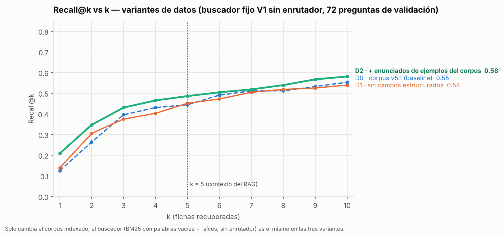

# Informe de sprint: EDA, feature engineering y variantes de datos

**Proyecto:** *Desarrollo y evaluación de un chatbot educativo basado en IA generativa y RAG para reforzar el aprendizaje de cinemática preuniversitaria en una academia de Chachapoyas*
**Autor:** Elmer Dante Rojas Zuta · Proyecto de Investigación II (MIA-UNI)
**Versión corregida.** Atiende las observaciones de la docente: se retira el enrutador de subtema y D2 ya no agrega datos externos. La versión entregada originalmente está en la rama `variantes-datos`.

## 1. Contexto

- **Objetivo del proyecto:** un tutor de cinemática por WhatsApp que, antes de responder, **recupera** fichas de una base de conocimiento validada y **genera** una respuesta pedagógica con un LLM (RAG). La pregunta técnica de la tesis es cuánto mejora la recuperación la corrección de las respuestas frente al mismo LLM sin recuperación.
- **Componente de este sprint:** la **recuperación**, porque si el buscador no entrega la ficha correcta, el LLM no puede responder bien. Se evalúa sin LLM, con costo de API cero.
- **Datos:**

| Conjunto | Contenido | Papel |
|---|---|---|
| Corpus v5.1 | 136 fichas: teoría, procedimientos y ejemplos resueltos | Lo que el chatbot consulta |
| Batería v4 | 400 preguntas (70 % material real de la academia Ágora y libros) con clave, solución y fichas esperadas | El examen. Partición 200 / 80 / 120 (desarrollo / validación / evaluación final) |
| Reserva de Ágora | 106 problemas reales verificados que **no** están en la batería | **No se usa en las variantes.** Es candidata para ampliar el corpus (v6), sección 6 |

- **Métrica central:** **Recall@5**, la proporción de las fichas esperadas de cada pregunta que aparece entre las 5 que se entregarán al LLM.
- **Métricas secundarias:** Recall@k, MRR@10, nDCG@5, Fallo@5, acierto de subtema, tiempo y costo.

### Resumen del EDA (detalle en [`results/eda/EDA_resumen.md`](../results/eda/EDA_resumen.md))

- **Corpus homogéneo:** 55–146 palabras por ficha, así que **una ficha = un fragmento**. Con k = 5, el contexto es de unos 800–1200 tokens.
- **Batería balanceada:** 80 preguntas por subtema; en cada uno, 18 de teoría, 18 por nivel de práctica y 8 no respondibles. La partición estratificada es exacta, con familias de preguntas parecidas sin partir.
- **Trazabilidad:** 890 preguntas revisadas = 694 verificadas + 196 no verificadas; se seleccionaron 280.
- **Sin filtración** entre batería y corpus.
- **Hallazgo accionable:** 11 preguntas tratan temas sin ficha específica (cobertura parcial).

### Resumen del feature engineering (detalle en [`experiments/feature_engineering/`](../experiments/feature_engineering/README.md))

- **Transformaciones del texto:** normalización, palabras vacías y raíces (Snowball), TF-IDF/LSA y un enrutador de subtema (TF-IDF + regresión logística).
- **Regla de ajuste:** todo se ajusta solo con el corpus o con preguntas de entrenamiento.
- **Resultado del avance:** V1 (palabras vacías + raíces) subió el Recall@5 de 0,377 a 0,444; V3 (V1 + enrutador) llegó a 0,470 (p = 0,03 frente a B0).
- **Diagnóstico:** lo que falla es la ficha exacta en problemas de práctica (Recall@5 ≈ 0,30). **El cuello de botella son los datos.**

### Cambio respecto del avance anterior: se retira el enrutador de subtema

Siguiendo la observación de la docente, el buscador de este sprint es **V1, sin enrutador**:

- **Aporte no significativo:** V3 frente a V1 da +0,025 de Recall@5 (p = 0,26).
- **Más simple y más general:** el enrutador es un segundo modelo entrenado aparte, que depende de los 5 subtemas en que está organizada la batería. Las preguntas reales pueden mezclar temas o no encajar en ninguno.
- **Regla del proyecto:** entre configuraciones sin diferencia significativa, se elige la más simple.

El enrutador se conserva solo como **prueba adicional** (sección 4), para documentar cuánto aportaba.

## 2. Línea base

| Etapa | Línea base | Recall@5 (validación) |
|---|---|---|
| Feature engineering | B0: BM25 con normalización mínima | 0,377 |
| **Este sprint (variantes de datos)** | **D0: buscador V1 (sin enrutador) sobre el corpus v5.1 sin cambios** | **0,444** |

En este sprint el buscador queda **fijo** (V1) y solo cambian **los datos**, como pide la tarea.

## 3. Experimentos A/B: un cambio por variante, en los datos

**Las tres variantes usan las mismas 136 fichas.** Solo cambia el texto de cada ficha que se indexa:

| Variante | Qué cambia en los datos | Por qué |
|---|---|---|
| **D0** baseline | Nada: corpus v5.1 (título + contenido + relaciones + condiciones + error frecuente) | Referencia |
| **D1** | Se quitan los campos estructurados (relaciones, condiciones, error frecuente): solo título + contenido | ¿Esos campos ayudan a buscar o meten ruido? |
| **D2** | A cada ficha de teoría o procedimiento se le agrega el **enunciado de los ejemplos resueltos del propio corpus** de su mismo subtema con los que se vincula | Dar a las fichas lenguaje de problema **sin agregar datos nuevos** |

**Reglas de D2:**
- **Vínculo:** cada ejemplo se vincula con sus *n* fichas más parecidas de su subtema, usando BM25 solo entre textos del corpus.
- **Elección de *n*:** *n* = 3, elegido con CV en desarrollo entre {1, 2, 3}.
- **Anti-fuga:** se excluyen los ejemplos parecidos a cualquier pregunta de la batería (Jaccard > 0,45). Quedan 22 de 35.
- **Uso:** el texto agregado solo sirve para buscar; al LLM se le entrega la ficha original.

## 4. Resultados comparables

**Tabla (holdout de validación, 72 preguntas respondibles):**

| Variante | **Recall@5** (IC 95 %) | Δ vs D0 (IC 95 %; p) | Recall@5 práctica | Recall@5 teoría | Recall@1 | MRR@10 | Fallo@5 | Latencia por consulta | Costo API |
|---|---|---|---|---|---|---|---|---|---|
| D0 baseline | 0,444 (0,340–0,549) | — | 0,30 | 0,89 | 0,125 | 0,314 | 49 % | < 1 ms | 0 |
| D1 sin campos | 0,451 (0,347–0,556) | +0,007 (−0,049; +0,062; p = 0,92) | 0,33 | 0,81 | 0,139 | 0,321 | 49 % | < 1 ms | 0 |
| D2 + enunciados de ejemplos | 0,486 (0,375–0,597) | +0,042 (−0,021; +0,104; p = 0,21) | 0,35 | 0,89 | 0,208 | 0,390 | 47 % | < 1 ms | 0 |

**Gráfico único: Recall@k vs k**



- **Ninguna variante supera a D0 de forma significativa.**
- **D2:** queda algo por encima en todos los k y mejora el ranking (Recall@1 de 0,125 a 0,208), pero la diferencia en Recall@5 no es significativa. En la validación cruzada supera a D0 en 3 de 5 particiones (0,465 → 0,488).
- **D1:** empeora la teoría (0,89 → 0,81). Los campos estructurados ayudan.
- **Sensibilidad al filtro anti-fuga:**
  - **sin filtro**, D2 llegaría a 0,549 (+0,10; p = 0,008);
  - esa «mejora» viene de trasladar a las fichas 13 ejemplos que se parecen a preguntas de la batería;
  - con la regla aplicada desaparece, y con ≤ 0,35 es nula (−0,014; p = 0,72).

**Prueba adicional: el enrutador retirado** ([`prueba_enrutador.csv`](../experiments/variantes_datos/resultados/prueba_enrutador.csv))

| Corpus | Sin enrutador (V1) | Con enrutador (V3) | Δ (IC 95 %; p) | Particiones de CV que gana el enrutador |
|---|---|---|---|---|
| D0 | 0,444 | 0,470 | +0,025 (−0,021; +0,065; p = 0,26) | 4 de 5 |
| D2 | 0,486 | 0,532 | +0,046 (+0,005; +0,097; p = 0,03) | 5 de 5 |

- **Sobre el corpus adoptado (D0):** el enrutador no aporta de forma significativa.
- **Sobre D2:** la diferencia sí es significativa, aunque en el límite. Se reporta con transparencia; la decisión de retirarlo se mantiene por simplicidad y generalidad.

## 5. Validación

- **Split:** estratificado (subtema × componente × nivel) y **agrupado por familia**, con semilla fija (20261015) y partición congelada con su huella SHA-256.
- **Validación cruzada:** `StratifiedGroupKFold(5)` en desarrollo. El único ajuste del sprint, el *n* de D2, se elige solo con esta CV.
- **Holdout:** validación, una ejecución por variante. La **evaluación final no se ha usado**.
- **Cero leakage, verificado por script** ([`verificar_fugas.py`](../experiments/variantes_datos/verificar_fugas.py) → `todo_ok = true`):
  - los enunciados que agrega D2 son todos del corpus, con similitud máxima de 0,441 con la batería;
  - no hay familias partidas;
  - los logs solo contienen preguntas de validación.

## 6. Conclusión y decisión

- **Se mantiene D0** (corpus v5.1) con el buscador V1 (BM25 + palabras vacías + raíces, **sin enrutador**). Ninguna variante construida con los mismos datos lo supera de forma significativa.
- **Se descarta D1:** no mejora y empeora la teoría.
- **D2 no se adopta:** su mejora no es significativa con la regla anti-fuga. Muestra que el corpus actual no tiene suficientes ejemplos «limpios» para dar a las fichas el lenguaje de los problemas.
- **Se retira el enrutador de subtema:** sobre D0 su aporte no es significativo, y agrega un modelo entrenado aparte.
- **Lección del sprint:** con el mismo corpus no se logra mejorar la búsqueda en problemas de práctica. Para eso hacen falta **datos nuevos**.
  - **Exploración, no comparable como variante:** agregar 73 problemas de la reserva de Ágora sube el Recall@5 a 0,576 (p = 0,01).
  - **Por qué no es una variante:** mete información que D0 y D1 no tienen, y la reserva sale de la misma fuente que la batería.
  - **Tratamiento:** se evaluará como **corpus v6**, construido y congelado antes de medirlo, con el examen final sellado y preguntas nuevas independientes.

## 7. Reproducibilidad

```bash
pip install -r requirements.txt
python src/preparar_ejemplos_d2.py --privado <carpeta_privada>  # solo si se recalcula el parecido de los ejemplos (requiere la batería privada)
python experiments/variantes_datos/ejecutar.py                 # experimentos (≈ 30 s)
python experiments/variantes_datos/graficar.py                 # gráfico
python experiments/variantes_datos/verificar_fugas.py          # verificación de cero leakage
jupyter nbconvert --to notebook --execute notebooks/03_variantes_datos.ipynb
```

| Qué | Dónde |
|---|---|
| Logs por consulta y configuración de cada variante | `experiments/variantes_datos/runs/dv-<variante>-<hash>/` (`config.yaml`, `log.jsonl`, `metricas.json`) |
| Tablas y gráfico | `experiments/variantes_datos/resultados/` |
| Datos de la variante D2 | `data/corpus/variantes/ejemplos_jaccard.json`: similitud de cada ejemplo con la batería (solo números). Elección de *n*: `resultados/eleccion_n_D2.csv` |
| Resultados desde un clon limpio | Con la batería pública (sin los enunciados de libros), Recall@5: D0 = 0,452, D1 = 0,444 y D2 = 0,452. La conclusión es la misma: ninguna variante supera a D0 |
| Huellas de los datos | Corpus: `data/corpus/manifest.json` (SHA-256 por ficha). Batería: `data/bateria/README.md` (SHA-256 de la versión congelada) |

## 8. Riesgos y próximos pasos

- **Riesgo de sesgo optimista:** los problemas de la academia y los ejemplos del corpus se repiten por tipos. Sin el filtro anti-fuga, las mejoras aparentes se inflan, como mostró la sensibilidad de D2. El filtro se fija **antes** de medir.
- **Riesgo de drift:** si la academia cambia su material o su forma de redactar, el corpus debe actualizarse.
- **Sesgo de la batería:** la teoría y las no respondibles son en su mayoría generadas y están pendientes de revisión docente.
- **Subtemas débiles:** MRUV y caída libre siguen en Recall@5 ≈ 0,21–0,25.
- **Próximos pasos:**
  1. Construir el **corpus v6** con fichas faltantes (sombras, vectores, cruce de un río), ejemplos resueltos nuevos de MRUV, caída libre y MCU, y problemas de la reserva que pasen el filtro.
  2. Probar búsqueda semántica (embeddings).
  3. Iniciar el experimento de generación: **LLM solo frente a LLM + RAG**.
