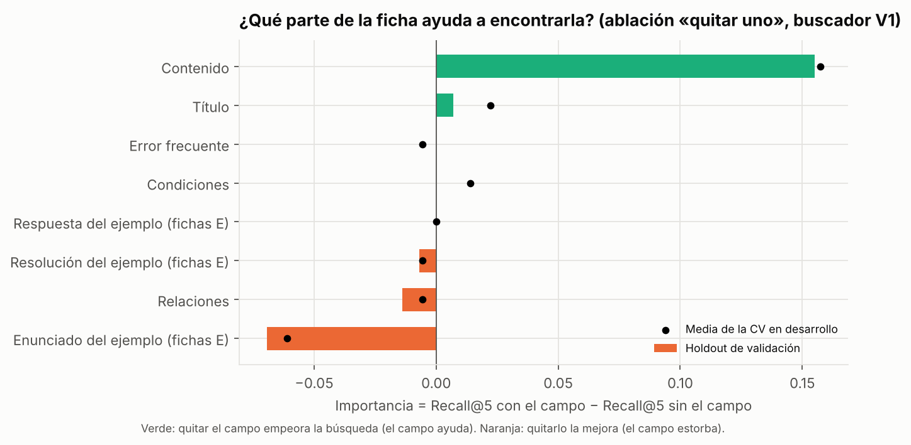
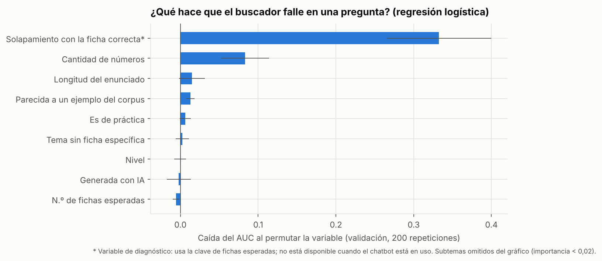

# Importancia de variables del buscador

**Proyecto:** chatbot educativo de cinemática basado en LLM + RAG (MIA-UNI)
**Autor:** Elmer Dante Rojas Zuta
**Notebook ejecutado:** [`notebooks/04_importancia_variables.ipynb`](../../notebooks/04_importancia_variables.ipynb)
**Matriz de consistencia:** [`docs/matriz_consistencia.md`](../../docs/matriz_consistencia.md)

## 1. Qué se analiza y por qué

El sprint anterior cerró con esta configuración: **buscador V1** (BM25 + palabras vacías + raíces, sin enrutador) sobre el **corpus v5.1** (D0), con Recall@5 = 0,444 en validación. Ninguna variante de datos la superó.

Para mejorarla hay que saber **qué variables pesan** en el resultado. Se estudian dos tipos:

| Tipo de variable | Pregunta | Método |
|---|---|---|
| **A. De los datos:** los campos de cada ficha | ¿Qué parte del texto de la ficha ayuda a encontrarla? | **Ablación «quitar uno»:** se retira un campo de las 136 fichas a la vez y se mide cuánto cambia el Recall@5 |
| **B. De las preguntas:** sus características | ¿Qué hace que el buscador falle en una pregunta? | **Modelo explicativo** del Fallo@5 (ninguna ficha correcta entre las 5): regresión logística estandarizada y bosque aleatorio, con **importancia por permutación** |

**Protocolo (el mismo de los sprints anteriores):**
- **A:** se mide con la CV de 5 particiones en desarrollo y, una vez, en el holdout de validación, con bootstrap pareado.
- **B:** los modelos se **entrenan solo con desarrollo** (180 preguntas respondibles) y se validan con CV agrupada por familia. La importancia por permutación se calcula en el **holdout de validación** (72 preguntas).
- **La evaluación final no se usa.**

## 2. Resultados A: importancia de los campos de la ficha



| Campo | Palabras por ficha | Importancia (CV) | Importancia (validación) | IC 95 % | p |
|---|---|---|---|---|---|
| **Contenido** | 56,7 | **+0,157** | **+0,155** | [+0,083; +0,236] | **< 0,001** |
| Título | 6,5 | +0,022 | +0,007 | [−0,021; +0,042] | 0,96 |
| Condiciones | 1,7 | +0,014 | 0,000 | — | 1,00 |
| Error frecuente | 6,8 | −0,006 | 0,000 | [−0,042; +0,042] | 1,00 |
| Relaciones | 6,8 | −0,006 | −0,014 | [−0,056; +0,028] | 0,79 |
| Resolución (fichas de ejemplo) | 10,5 | −0,006 | −0,007 | [−0,021; 0,000] | 0,73 |
| **Enunciado (fichas de ejemplo)** | 9,9 | **−0,061** | **−0,069** | [−0,125; −0,028] | **< 0,001** |

*Importancia = Recall@5 con el campo − Recall@5 sin el campo. Positiva: el campo ayuda. Negativa: el campo estorba.*

**Lectura:**
1. **El contenido es la variable de datos decisiva.** Sin él, el Recall@5 cae de 0,444 a 0,289. El título aporta poco, y las relaciones, condiciones y errores frecuentes casi nada para *buscar*. Esos campos se mantienen porque sirven al LLM para *responder*.
2. **El enunciado de las fichas de ejemplo resuelto estorba**, y de forma significativa. Si se retira del índice, el Recall@5 **sube** de 0,444 a 0,514. La razón:
   - las 35 fichas de ejemplo están escritas como problemas, así que se parecen a las preguntas de práctica y **ocupan lugares del top-5**;
   - pero la clave de la batería nunca las marca como esperadas: las 526 fichas esperadas son de teoría o procedimiento.
   - En validación, **2,4 de las 5 fichas recuperadas son, en promedio, fichas de ejemplo.**
   - **Ojo:** parte de este efecto depende de esa convención de anotación. Un ejemplo resuelto parecido también puede servirle al LLM para responder. Antes de cambiar el índice hay que decidir el papel de los ejemplos: anotarlos como relevantes, fusionarlos con su ficha o bajarles el peso.

## 3. Resultados B: qué hace fallar al buscador



**Calidad de los modelos explicativos:**

| Modelo | AUC en la CV de desarrollo | AUC en validación |
|---|---|---|
| Regresión logística | 0,84 ± 0,09 | 0,87 |
| Bosque aleatorio | 0,84 ± 0,06 | 0,84 |

**Coeficientes estandarizados de la regresión logística** (odds ratio por cada desviación estándar):

| Variable | Coeficiente | Odds ratio | Lectura |
|---|---|---|---|
| **Solapamiento con la ficha correcta*** | −2,08 | **0,12** | Si la pregunta comparte más palabras con la ficha correcta, el riesgo de fallo cae mucho |
| **Cantidad de números** | +1,03 | **2,81** | Los enunciados con muchos datos numéricos fallan más |
| Generada con IA | +0,46 | 1,58 | Efecto pequeño una vez controlado el solapamiento |
| Longitud del enunciado | −0,51 | 0,60 | Efecto pequeño |
| Subtema, nivel, práctica, tema sin ficha | entre −0,3 y +0,3 | 0,7–1,3 | Poco peso una vez controladas las anteriores |

\* *Variable de diagnóstico: se calcula con la clave (fichas esperadas), así que no está disponible cuando el chatbot está en uso. Sirve para explicar el fallo, no para predecirlo en producción.*

**Tasa de fallo por grupo** (desarrollo + validación, 252 preguntas; [`tasa_fallo_por_grupo.csv`](resultados/tasa_fallo_por_grupo.csv)):

| Variable | Grupo → tasa de Fallo@5 |
|---|---|
| Componente | teoría **14 %** · práctica **60 %** |
| Solapamiento con la ficha correcta (terciles) | bajo **82 %** · medio 50 % · alto **12 %** |
| Subtema | MCU 33 % · MRU 40 % · MPCL 49 % · MVCL 56 % · MRUV 64 % |
| Tema sin ficha específica | sí 90 % (n = 10) · no 47 % |

**Lectura:**
- La práctica falla más que la teoría (60 % frente a 14 %). Pero, una vez que el modelo conoce el **solapamiento de vocabulario** y la **cantidad de números**, ser de práctica casi no agrega información.
- **El buscador falla cuando la pregunta no usa las palabras de la ficha.** Es un problema de vocabulario, y es el límite natural de un buscador por palabras como BM25.

## 4. Conclusiones y qué cambia en el proyecto

| Hallazgo | Acción propuesta |
|---|---|
| El contenido es lo que permite encontrar una ficha | En el corpus v6, cuidar que el contenido use también el **vocabulario de los problemas** («móvil», «se lanza», «alcanza») |
| El fallo se explica sobre todo por la falta de palabras compartidas | Probar **búsqueda semántica (embeddings)**, que compara significados y no solo palabras |
| El enunciado de las fichas de ejemplo ocupa lugares del top-5 | Decidir el papel de los ejemplos en el índice; se evaluará como hiperparámetro, con CV en desarrollo, en el sprint de optimización |
| Los enunciados con muchos números fallan más | Explorar normalizar números y unidades en la consulta |
| MRUV y caída libre son los subtemas más débiles | Priorizarlos al ampliar el corpus |

## 5. Reproducibilidad

```bash
pip install -r requirements.txt
python experiments/importancia_variables/ejecutar.py   # A + B (≈ 1,5 min) → resultados/*.csv, resumen.json
python experiments/importancia_variables/graficar.py   # resultados/importancia_campos.png, importancia_preguntas.png
jupyter nbconvert --to notebook --execute notebooks/04_importancia_variables.ipynb
```

- **Batería:** se usa la batería completa (privada). Desde un clon limpio se usa la pública, que omite los enunciados de libros, y los números cambian ligeramente.
- **Semilla:** 20261015 en la CV, el bosque aleatorio y la permutación.
