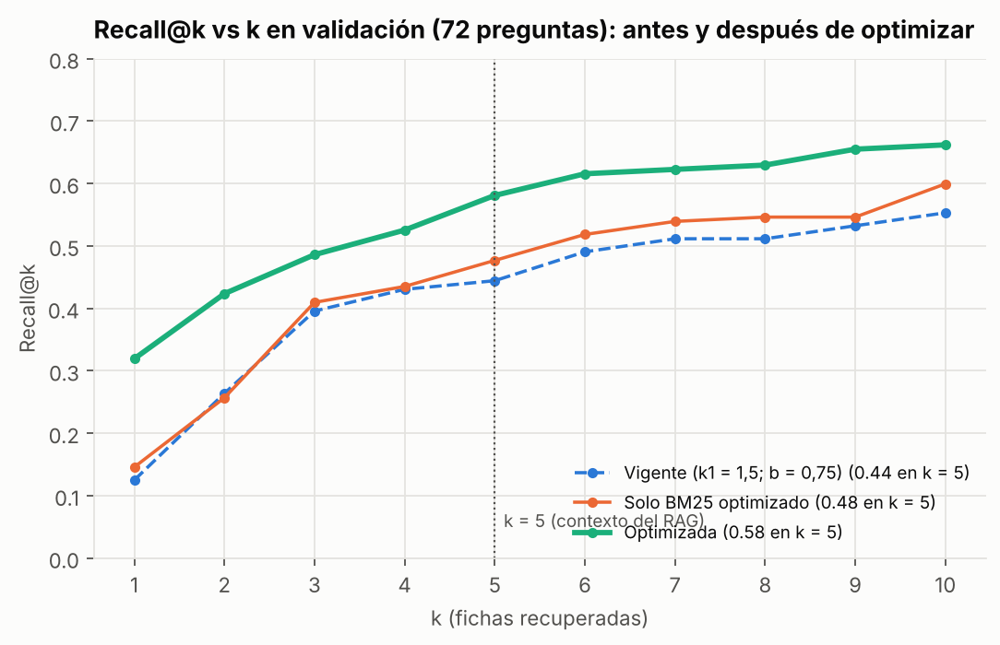
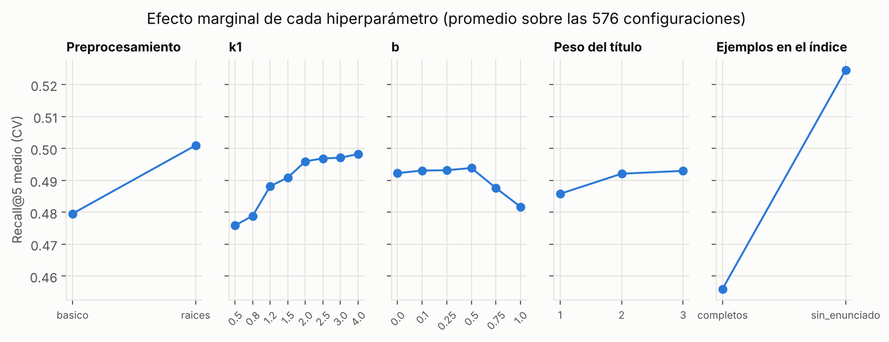
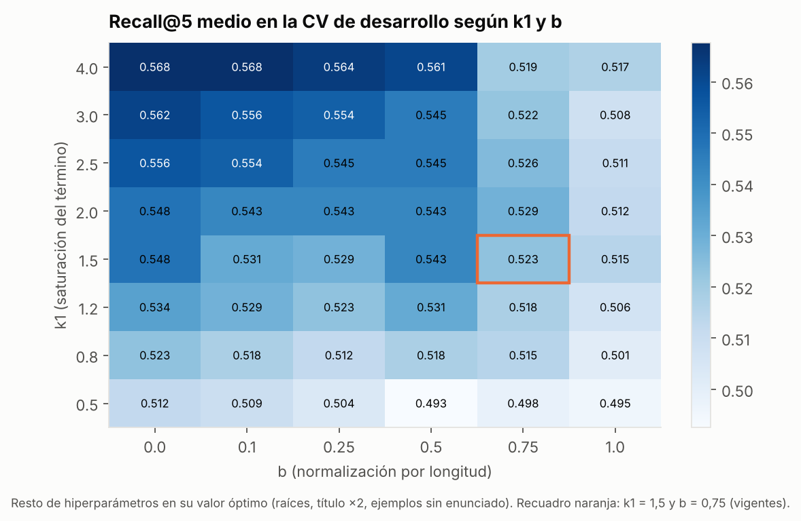

# Optimización de hiperparámetros del buscador

**Proyecto:** chatbot educativo de cinemática basado en LLM + RAG (MIA-UNI)
**Autor:** Elmer Dante Rojas Zuta
**Notebook ejecutado (recorrido completo del sprint hasta la optimización):** [`notebooks/05_optimizacion_hiperparametros.ipynb`](../../notebooks/05_optimizacion_hiperparametros.ipynb)

## 1. Punto de partida y qué se optimiza

- **Configuración vigente:** buscador V1, es decir, BM25 con palabras vacías y raíces, k1 = 1,5, b = 0,75 y sin enrutador, sobre el corpus v5.1. Recall@5 = 0,444 en validación.
- **Hallazgo del sprint de importancia de variables:** el enunciado de las fichas de ejemplo ocupa lugares del top-5. Por eso el papel de los ejemplos entra aquí como un hiperparámetro más.

| Hiperparámetro | Qué controla (en simple) | Valores probados | Vigente |
|---|---|---|---|
| `preprocesamiento` | Si se reducen las palabras a su raíz («caminando» → «camin») | basico · raices | raices |
| `k1` | Cuánto «premia» BM25 que una palabra se repita en la ficha. Bajo: basta con que aparezca una vez. Alto: cada repetición suma | 0,5 · 0,8 · 1,2 · 1,5 · 2,0 · 2,5 · 3,0 · 4,0 | 1,5 |
| `b` | Cuánto se castiga a las fichas largas. 0: nada; 1: castigo completo | 0 · 0,1 · 0,25 · 0,5 · 0,75 · 1,0 | 0,75 |
| `peso_titulo` | Cuántas veces se repite el título en el texto indexado | 1 · 2 · 3 | 1 |
| `ejemplos` | Si las fichas de ejemplo resuelto se indexan con su enunciado o sin él (conservan título, resolución y respuesta) | completos · sin_enunciado | completos |

**Rejilla completa:** 2 × 8 × 6 × 3 × 2 = **576 configuraciones**.

**El número de fichas k no se optimiza.** El Recall@k siempre crece con k, así que se fija en **k = 5** por el presupuesto de contexto del LLM (EDA: unos 800–1200 tokens).

## 2. Protocolo (sin fuga)

1. **Selección con validación cruzada en desarrollo:**
   - 5 particiones con `StratifiedGroupKFold`, por subtema y familia, con semilla 20261015;
   - se elige el mayor Recall@5 medio y, en caso de empate, la configuración con menos cambios respecto de la vigente.
2. **Estimación honesta con CV anidada:** en cada una de las 5 particiones externas, la selección se repite usando solo las otras 4, y la configuración elegida se mide en la partición que quedó fuera. Así se estima cuánto se gana *de verdad* al ajustar, sin el optimismo de elegir y medir con los mismos datos.
3. **Control de borde:** k1 = 4,0 quedó en el extremo de la rejilla, así que se probó más allá (6, 8 y 12). El resultado se mantiene en una **meseta**: 0,568 · 0,567 · 0,556 · 0,569 ([`control_borde_k1.csv`](resultados/control_borde_k1.csv)).
4. **Comparación final en el holdout de validación, una sola vez,** con bootstrap pareado. Se compara la vigente contra dos candidatas:
   - **optimizada:** todos los hiperparámetros;
   - **solo BM25:** solo los hiperparámetros del buscador, con los ejemplos completos. Sirve para separar los dos efectos.
5. **Cero leakage verificado:** [`verificar_fugas.py`](verificar_fugas.py) → `todo_ok = true`. La evaluación final no se usó.

## 3. Resultados

### 3.1 Comparación final (holdout de validación, 72 preguntas)

| Candidata | Hiperparámetros | Recall@5 CV (desarrollo) | **Recall@5 validación** (IC 95 %) | Δ vs vigente (IC 95 %; p) | Recall@1 | MRR@10 | Fallo@5 | Práctica | Teoría |
|---|---|---|---|---|---|---|---|---|---|
| Vigente | raíces · k1 1,5 · b 0,75 · título ×1 · ejemplos completos | 0,465 | 0,444 (0,340–0,549) | — | 0,125 | 0,314 | 0,486 | 0,30 | 0,89 |
| Solo BM25 | raíces · k1 3,0 · b 0 · título ×3 · ejemplos completos | 0,495 | 0,477 (0,373–0,583) | +0,032 (−0,019; +0,088; p = 0,26) | 0,146 | 0,339 | 0,444 | 0,33 | 0,91 |
| **Optimizada** | raíces · **k1 4,0 · b 0,1 · título ×2 · ejemplos sin enunciado** | **0,568** | **0,581** (0,479–0,681) | **+0,137 (+0,074; +0,206; p < 0,001)** | **0,319** | **0,504** | **0,333** | **0,47** | 0,91 |



### 3.2 Estimación sin optimismo (CV anidada)

| Partición externa | Configuración elegida con las otras 4 | Vigente | Seleccionada |
|---|---|---|---|
| 1 | raíces · k1 4,0 · b 0 · título ×2 · sin enunciado | 0,403 | 0,514 |
| 2 | raíces · k1 4,0 · b 0 · título ×2 · sin enunciado | 0,583 | 0,694 |
| 3 | raíces · k1 2,5 · b 0 · título ×2 · sin enunciado | 0,319 | 0,375 |
| 4 | raíces · k1 4,0 · b 0,1 · título ×2 · sin enunciado | 0,519 | 0,574 |
| 5 | raíces · k1 4,0 · b 0,1 · título ×2 · sin enunciado | 0,500 | 0,611 |
| **Media** | | **0,465** | **0,554** |

- **Ganancia estable:** la configuración ajustada mejora en las **5 de 5** particiones, y la elección es casi la misma en todas.
- **Coincidencia con el holdout:** la ganancia estimada (+0,09) es del mismo orden que la del holdout (+0,14).

### 3.3 ¿Qué hiperparámetro importa más?



**Importancia** = diferencia entre el mejor y el peor valor del Recall@5 medio de cada hiperparámetro ([`importancia_hiperparametros.csv`](resultados/importancia_hiperparametros.csv)):

| Hiperparámetro | Importancia | Lectura |
|---|---|---|
| **ejemplos** | **0,069** | Lo que más pesa: quitar el enunciado de las fichas de ejemplo libera lugares del top-5 |
| k1 | 0,022 | Valores altos ayudan: conviene premiar que la ficha repita los términos de la pregunta |
| preprocesamiento | 0,021 | Las raíces ayudan |
| b | 0,012 | Castigar poco la longitud (b ≤ 0,5) es mejor que el valor estándar de 0,75 |
| peso_titulo | 0,007 | Casi no influye |



## 4. Decisión y cautelas

- **Se adopta la configuración optimizada:** raíces, k1 = 4,0, b = 0,1, título ×2 y ejemplos sin enunciado.
  - Recall@5 en validación: de 0,444 a **0,581** (+13,7 puntos, p < 0,001).
  - La CV anidada confirma la ganancia sin optimismo: +9 puntos, en 5 de 5 particiones.
  - Fallo@5 baja del 49 % al 33 %; en práctica, el Recall@5 pasa de 0,30 a 0,47.
  - Costo cero y menos de 1 ms por consulta.
- **De dónde viene la ganancia:** casi toda viene de `ejemplos = sin_enunciado`. Ajustar solo los parámetros de BM25 suma +3 puntos, que no son significativos (p = 0,26).
- **Cautela importante:**
  - la clave de la batería nunca marca las fichas de ejemplo como esperadas, así que quitarles peso **favorece a la métrica por construcción**;
  - un ejemplo resuelto parecido podría ser útil al LLM para responder;
  - por eso la decisión es **provisional**: se confirmará en el experimento de generación (LLM + RAG) y, si conviene, se revisará la clave para considerar los ejemplos.
- **Este cambio no es una variante de datos:** no se agrega información; solo cambia qué parte de las fichas existentes se usa para buscar. El LLM sigue recibiendo la ficha completa.

## 5. Reproducibilidad

```bash
pip install -r requirements.txt
python experiments/optimizacion_hiperparametros/ejecutar.py        # rejilla + CV anidada + control de borde + validación (≈ 1,5 min)
python experiments/optimizacion_hiperparametros/graficar.py        # mapa_k1_b.png, efecto_marginal.png, recall_vs_k.png
python experiments/optimizacion_hiperparametros/verificar_fugas.py # verificacion_fugas.json
jupyter nbconvert --to notebook --execute notebooks/05_optimizacion_hiperparametros.ipynb
```

| Qué | Dónde |
|---|---|
| Las 576 configuraciones con su Recall@5 por partición | `resultados/rejilla_cv.csv` |
| CV anidada | `resultados/cv_anidada.csv` |
| Comparación final | `resultados/tabla_final.csv` |
| Registro de cada ejecución en validación | `runs/ho-<candidata>-<hash>/` (`config.yaml`, `log.jsonl`, `metricas.json`) |
| Resumen | `resultados/resumen.json` |
