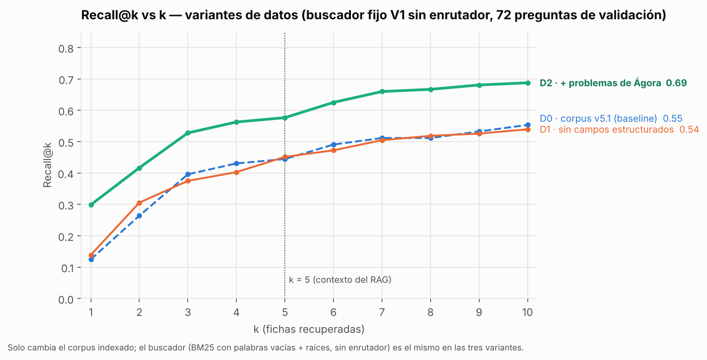

# Variantes de datos: experimentos A/B sobre el corpus

**Proyecto:** chatbot educativo de cinemática basado en LLM + RAG (MIA-UNI)
**Autor:** Elmer Dante Rojas Zuta
**Informe de sprint completo:** [`docs/informe_sprint.md`](../../docs/informe_sprint.md)
**Notebook ejecutado:** [`notebooks/03_variantes_datos.ipynb`](../../notebooks/03_variantes_datos.ipynb)

## 1. Qué se compara

En el avance de feature engineering se probaron cuatro buscadores. Ese avance mostró que el cuello de botella ya no era el buscador, sino **los datos**: en problemas de práctica el corpus no tenía suficiente material del tipo de la academia.

**Buscador de este sprint: V1** (BM25 + palabras vacías + raíces), **sin el enrutador de subtema** de V3. Se retiró siguiendo la observación de la docente:

- **Aporte no significativo:** frente a V1, el enrutador suma +0,025 de Recall@5 (p = 0,26).
- **Más simple y general:** es un segundo modelo entrenado aparte que depende de los 5 subtemas de la batería.
- **Prueba adicional:** se documenta en la sección 2.

En este experimento **el buscador queda fijo** y **solo cambia el corpus** que se indexa:

| Variante | Único cambio | Por qué |
|---|---|---|
| **D0 · baseline** | Corpus v5.1 tal cual: título + contenido + ecuaciones + error frecuente | Punto de partida |
| **D1** | Se indexa solo título + contenido, sin los campos estructurados (ecuaciones, condiciones y error frecuente) | Saber si esos campos ayudan a buscar o meten ruido |
| **D2** | Al texto indexado de cada ficha se le agregan hasta 5 **problemas reales de Ágora** que la usan | Acercar el vocabulario del corpus al de los problemas reales, donde el buscador fallaba |

- **Origen de los problemas de D2:** salen de la **reserva**, que son preguntas de Ágora con clave verificada que **no** entraron a la batería. Se indica a qué ficha se agrega cada problema según su anotación de fichas relevantes.
- **Uso de la expansión:** solo sirve para **buscar**. Al LLM se le entrega la ficha original, así que el costo en tokens no cambia.
- **Construcción:** [`src/preparar_expansion.py`](../../src/preparar_expansion.py).
- **Resultado:** [`data/corpus/variantes/expansion_agora.jsonl`](../../data/corpus/variantes/expansion_agora.jsonl). Se agregaron 104 entradas a 48 fichas, a partir de 73 problemas distintos.

**Control de fuga:** se descartó todo problema de la reserva cuya similitud de Jaccard con **cualquier** pregunta de la batería (desarrollo, validación o evaluación final) superara 0,45, el mismo umbral que el EDA usa para «estructura parecida». Se descartaron 32 de 106 problemas.

## 2. Tabla estándar (holdout de validación, 72 preguntas respondibles)

| Variante | **Recall@5** (IC 95 %) | Δ vs D0 (IC 95 %; p) | Recall@5 práctica | Recall@5 teoría | Recall@10 | MRR@10 | Fallo@5 | Subtema@1 | Palabras indexadas por ficha | Índice / consulta (ms) | Costo API |
|---|---|---|---|---|---|---|---|---|---|---|---|
| **D0** corpus v5.1 | 0,444 (0,340–0,549) | — | 0,30 | 0,89 | 0,553 | 0,314 | 0,486 | 0,69 | 102 | 21 / 0,6 | 0 |
| **D1** sin campos | 0,451 (0,347–0,556) | +0,007 (−0,049; +0,062; p = 0,92) | 0,33 | 0,81 | 0,539 | 0,321 | 0,486 | 0,68 | 87 | 13 / 0,5 | 0 |
| **D2** + problemas Ágora | **0,576** (0,479–0,674) | **+0,132** (+0,035; +0,229; **p = 0,01**) | **0,47** | 0,89 | **0,688** | **0,514** | **0,333** | 0,76 | 131 | 19 / 0,7 | 0 |

- **Δ e IC:** son diferencias pareadas sobre las mismas 72 preguntas, con bootstrap de 5000 remuestreos.
- **Práctica, D2 vs D0:** +0,176 (p = 0,01).
- **Con el buscador más simple** (BM25 sin raíces), D2 también mejora: 0,377 → 0,553. El efecto de los datos no depende del buscador.
- **Tiempos:** varían algo entre ejecuciones; las métricas no.

### Gráfico clave: Recall@k vs k



D2 está por encima de D0 y D1 en todos los valores de k, de 1 a 10.

### Estabilidad: validación cruzada de 5 particiones en desarrollo (180 preguntas)

| Variante | Recall@5 media ± de | Recall@10 | MRR@10 | Recall@5 con BM25 sin raíces |
|---|---|---|---|---|
| D0 | 0,465 ± 0,104 | 0,592 | 0,369 | 0,434 |
| D1 | 0,459 ± 0,114 | 0,608 | 0,357 | 0,429 |
| D2 | **0,534 ± 0,053** | **0,729** | **0,466** | 0,574 |

- **D2 es mejor que D0 en 4 de las 5 particiones**, y su dispersión entre particiones es la menor.
- **Raíces con D2:** con el corpus expandido, en la CV, BM25 sin raíces (0,574) supera a V1 (0,534), mientras que en el holdout ocurre lo contrario (0,553 frente a 0,576). Las raíces se mantienen, y se volverán a comparar con el corpus v6.

### Por subtema (Recall@5 en validación)

| | MRU | MRUV | MVCL | MPCL | MCU |
|---|---|---|---|---|---|
| D0 | 0,50 | 0,21 | 0,21 | 0,60 | 0,67 |
| D2 | **0,61** | **0,57** | **0,43** | **0,73** | 0,53 |

La mejora se concentra en MRUV y MVCL, los dos subtemas más débiles del baseline. En MCU baja: es un punto a revisar en el corpus v6.

### Análisis de sensibilidad: ¿la mejora depende de problemas «demasiado parecidos»?

Se repitió D2 exigiendo que los problemas agregados se parezcan cada vez menos a la batería:

| Umbral de Jaccard | Entradas agregadas | Recall@5 | Δ vs D0 | p |
|---|---|---|---|---|
| ≤ 0,45 (usado) | 104 | 0,576 | +0,132 | 0,010 |
| ≤ 0,40 | 78 | 0,549 | +0,104 | 0,014 |
| ≤ 0,35 | 46 | 0,556 | +0,111 | 0,013 |
| ≤ 0,30 | 21 | 0,465 | +0,021 | 0,59 |

- **Hasta un umbral de 0,35**, la mejora se mantiene y es significativa.
- **Con 0,30** quedan tan pocos problemas que el efecto desaparece. Eso indica que el beneficio viene de **la cantidad de material del mismo tipo**, no de copias.
- **Riesgo declarado:** parte del efecto viene de que los problemas de la academia se repiten por tipos. La evaluación final, que se ejecuta una sola vez, lo confirmará.

### Prueba adicional: el enrutador de subtema retirado

Archivo: [`resultados/prueba_enrutador.csv`](resultados/prueba_enrutador.csv). β se eligió con CV anidada solo en desarrollo.

| Corpus | Sin enrutador (V1) | Con enrutador (V3) | Δ (IC 95 %; p) | CV: sin / con | Particiones de CV que gana | Subtema@1 sin / con |
|---|---|---|---|---|---|---|
| D0 | 0,444 | 0,470 | +0,025 (−0,021; +0,065; p = 0,26) | 0,465 / 0,531 | 4 de 5 | 0,69 / 0,93 |
| D2 | 0,576 | 0,611 | +0,035 (−0,007; +0,090; p = 0,19) | 0,534 / 0,620 | 5 de 5 | 0,76 / 0,90 |

El enrutador acierta mejor el subtema y da una mejora pequeña y consistente, pero **no significativa** en el holdout. Se retira porque agrega un modelo entrenado aparte, que depende de la organización en 5 subtemas, a cambio de una ganancia no demostrada.

## 3. Decisión

- **Se adopta D2:** corpus v5.1 + expansión con problemas de Ágora, con el buscador V1 (sin enrutador).
  - Mejora Recall@5 en 13 puntos (p = 0,01) y la práctica en 18 puntos.
  - Reduce los fallos del 49 % al 33 %.
  - No tiene costo de API ni aumenta el contexto del LLM.
- **Se descarta D1:** quitar los campos estructurados no mejora (p = 0,92) y empeora la teoría (0,89 → 0,81). Las ecuaciones y los errores frecuentes se mantienen.
- **Se retira el enrutador de subtema** (sección 2, prueba adicional).

## 4. Validación y cero leakage

- **Misma partición y validación que el avance anterior:**
  - partición con semilla 20261015;
  - validación cruzada `StratifiedGroupKFold(5)`, estratificada por subtema y agrupada por familia;
  - el buscador V1 no ajusta nada con preguntas; en la prueba adicional del enrutador, β se elige con CV anidada solo en entrenamiento;
  - holdout de validación, ejecutado una vez por variante.
- **Verificación automática:** [`verificar_fugas.py`](verificar_fugas.py) → [`resultados/verificacion_fugas.json`](resultados/verificacion_fugas.json) con **todo_ok = true**.
  - Ningún problema de D2 está en la batería, y la similitud máxima es 0,448.
  - La partición es exacta y no hay familias partidas.
  - Ninguna partición de la CV comparte familias.
  - Los logs contienen solo preguntas de validación.
  - No hay textos protegidos.

## 5. Reproducibilidad

```bash
pip install -r requirements.txt
python experiments/variantes_datos/ejecutar.py        # CV + holdout + sensibilidad + prueba del enrutador (≈ 25 s)
python experiments/variantes_datos/graficar.py        # resultados/recall_vs_k.png
python experiments/variantes_datos/verificar_fugas.py # resultados/verificacion_fugas.json
```

- **Runs:** cada variante deja `runs/dv-<variante>-<hash>/` con su `config.yaml`, el `log.jsonl` por consulta y su `metricas.json`. El campo `commit` de los logs identifica la copia de trabajo en la que se ejecutó el experimento.
- **Expansión:** `data/corpus/variantes/expansion_agora.jsonl` guarda, para cada problema agregado, su fuente y su similitud máxima con la batería. El análisis de sensibilidad se reproduce sin datos privados.
- **Batería:** se usa la batería completa (privada). Desde un clon limpio se usa la pública, que omite los enunciados de las preguntas de libros, y los números cambian ligeramente: con ella, Recall@5 da D0 = 0,452, D1 = 0,444 y D2 = 0,619 (63 preguntas de validación). La conclusión es la misma.
