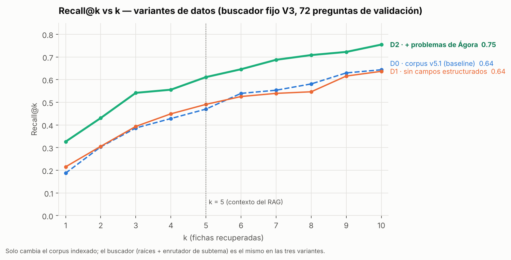

# Variantes de datos: experimentos A/B sobre el corpus

**Proyecto:** chatbot educativo de cinemática basado en LLM + RAG (MIA-UNI)
**Autor:** Elmer Dante Rojas Zuta
**Informe de sprint completo:** [`docs/informe_sprint.md`](../../docs/informe_sprint.md)
**Notebook ejecutado:** [`notebooks/03_variantes_datos.ipynb`](../../notebooks/03_variantes_datos.ipynb)

## 1. Qué se compara

En el avance de feature engineering se adoptó un buscador, V3 (BM25 con raíces + enrutador de subtema). Ese avance mostró que el cuello de botella ya no era el buscador, sino **los datos**: en problemas de práctica el corpus no tenía suficiente material del tipo de la academia.

En este experimento **el buscador queda fijo** y **solo cambia el corpus** que se indexa:

| Variante | Único cambio | Por qué |
|---|---|---|
| **D0 · baseline** | Corpus v5.1 tal cual: título + contenido + ecuaciones + error frecuente | Configuración adoptada en el avance anterior |
| **D1** | Se indexa solo título + contenido, sin los campos estructurados (ecuaciones, condiciones y error frecuente) | Saber si esos campos ayudan a buscar o meten ruido |
| **D2** | Al texto indexado de cada ficha se le agregan hasta 5 **problemas reales de Ágora** que la usan | Acercar el vocabulario del corpus al de los problemas reales, donde el buscador fallaba |

- **Origen de los problemas de D2:** salen de la **reserva**, que son preguntas de Ágora con clave verificada que **no** entraron a la batería. Se indica a qué ficha se agrega cada problema según su anotación de fichas relevantes.
- **Uso de la expansión:** solo sirve para **buscar**. Al LLM se le entrega la ficha original, así que el costo en tokens no cambia.
- **Construcción:** [`src/preparar_expansion.py`](../../src/preparar_expansion.py).
- **Resultado:** [`data/corpus/variantes/expansion_agora.jsonl`](../../data/corpus/variantes/expansion_agora.jsonl). Se agregaron 104 entradas a 48 fichas, a partir de 73 problemas distintos.

**Control de fuga:** se descartó todo problema de la reserva cuya similitud de Jaccard con **cualquier** pregunta de la batería (desarrollo, validación o evaluación final) superara 0,45, el mismo umbral que el EDA usa para «estructura parecida». Se descartaron 32 de 106 problemas.

## 2. Tabla estándar (holdout de validación, 72 preguntas respondibles)

| Variante | **Recall@5** (IC 95 %) | Δ vs D0 (IC 95 %; p) | Recall@5 práctica | Recall@5 teoría | Recall@10 | MRR@10 | Fallo@5 | Subtema@1 | Palabras indexadas por ficha | Índice / consulta (ms) | Costo API |
|---|---|---|---|---|---|---|---|---|---|---|---|
| **D0** corpus v5.1 | 0,470 (0,361–0,572) | — | 0,32 | 0,91 | 0,644 | 0,376 | 0,458 | 0,93 | 102 | 12 / 1,2 | 0 |
| **D1** sin campos | 0,491 (0,380–0,595) | +0,021 (−0,035; +0,076; p = 0,57) | 0,37 | 0,85 | 0,637 | 0,384 | 0,444 | 0,93 | 87 | 10 / 1,0 | 0 |
| **D2** + problemas Ágora | **0,611** (0,514–0,715) | **+0,141** (+0,051; +0,236; **p = 0,002**) | **0,52** | 0,89 | **0,755** | **0,539** | **0,319** | 0,90 | 131 | 17 / 1,2 | 0 |

- **Δ e IC:** son diferencias pareadas sobre las mismas 72 preguntas, con bootstrap de 5000 remuestreos.
- **Práctica, D2 vs D0:** +0,194 (p = 0,002).
- **Con el buscador más simple** (BM25 sin raíces ni enrutador), D2 también mejora: 0,377 → 0,553. El efecto de los datos no depende del buscador.
- **Tiempos:** varían algo entre ejecuciones; las métricas no.

### Gráfico clave: Recall@k vs k



### Estabilidad: validación cruzada de 5 particiones en desarrollo (180 preguntas)

| Variante | Recall@5 media ± de | Recall@10 | MRR@10 | β elegido (media) |
|---|---|---|---|---|
| D0 | 0,531 ± 0,086 | 0,665 | 0,395 | 2,4 |
| D1 | 0,523 ± 0,090 | 0,659 | 0,379 | 2,0 |
| D2 | **0,620 ± 0,090** | **0,794** | **0,510** | 0,8 |

D2 es mejor que D0 en **las 5 particiones**. Su β elegido es menor: con más vocabulario de problemas reales, el enrutador de subtema hace menos falta.

### Por subtema (Recall@5 en validación)

| | MRU | MRUV | MVCL | MPCL | MCU |
|---|---|---|---|---|---|
| D0 | 0,61 | 0,27 | 0,21 | 0,60 | 0,63 |
| D2 | 0,61 | **0,57** | **0,46** | 0,67 | 0,73 |

La mejora se concentra en MRUV y MVCL, los dos subtemas más débiles del baseline.

### Análisis de sensibilidad: ¿la mejora depende de problemas «demasiado parecidos»?

Se repitió D2 exigiendo que los problemas agregados se parezcan cada vez menos a la batería:

| Umbral de Jaccard | Entradas agregadas | Recall@5 | Δ vs D0 | p |
|---|---|---|---|---|
| ≤ 0,45 (usado) | 104 | 0,611 | +0,141 | 0,002 |
| ≤ 0,40 | 78 | 0,576 | +0,106 | 0,010 |
| ≤ 0,35 | 46 | 0,576 | +0,106 | 0,011 |
| ≤ 0,30 | 21 | 0,477 | +0,007 | 0,91 |

- **Hasta un umbral de 0,35**, la mejora se mantiene y es significativa.
- **Con 0,30** quedan tan pocos problemas que el efecto desaparece. Eso indica que el beneficio viene de **la cantidad de material del mismo tipo**, no de copias.
- **La mejora disminuye al endurecer el filtro.** Por eso se declara como riesgo: parte del efecto viene de que los problemas de la academia se repiten por tipos. La evaluación final, que se ejecuta una sola vez, lo confirmará.

## 3. Decisión

- **Se adopta D2:** corpus v5.1 + expansión con problemas de Ágora, con el mismo buscador V3.
  - Mejora Recall@5 en 14 puntos (p = 0,002) y la práctica en 19 puntos.
  - Reduce los fallos del 46 % al 32 %.
  - No tiene costo de API ni aumenta el contexto del LLM.
- **Se descarta D1:** quitar los campos estructurados no mejora de forma significativa y empeora la teoría (0,91 → 0,85). Las ecuaciones y los errores frecuentes se mantienen.

## 4. Validación y cero leakage

- **Misma partición y validación que el avance anterior:**
  - partición con semilla 20261015;
  - validación cruzada `StratifiedGroupKFold(5)`, estratificada por subtema y agrupada por familia;
  - β elegido con CV anidada solo en entrenamiento;
  - holdout de validación, ejecutado una vez por variante.
- **Verificación automática:** [`verificar_fugas.py`](verificar_fugas.py) → [`resultados/verificacion_fugas.json`](resultados/verificacion_fugas.json) con **todo_ok = true**.
  - Ningún problema de D2 está en la batería, y la similitud máxima es 0,448.
  - La partición es exacta y no hay familias partidas.
  - Ninguna partición de la CV comparte familias.
  - Los logs contienen solo preguntas de validación.
  - No hay textos protegidos.

## 5. Reproducibilidad

```bash
pip install -r requirements.txt
python experiments/variantes_datos/ejecutar.py        # CV + holdout + sensibilidad (≈ 30 s)
python experiments/variantes_datos/graficar.py        # resultados/recall_vs_k.png
python experiments/variantes_datos/verificar_fugas.py # resultados/verificacion_fugas.json
```

- **Runs:** cada variante deja `runs/dv-<variante>-<hash>/` con su `config.yaml`, el `log.jsonl` por consulta y su `metricas.json`. El campo `commit` de los logs identifica la copia de trabajo en la que se ejecutó el experimento.
- **Expansión:** `data/corpus/variantes/expansion_agora.jsonl` guarda, para cada problema agregado, su fuente y su similitud máxima con la batería. El análisis de sensibilidad se reproduce sin datos privados.
- **Batería:** se usa la batería completa (privada). Desde un clon limpio se usa la pública, que omite los enunciados de las preguntas de libros, y los números cambian ligeramente: con ella, Recall@5 da D0 = 0,474, D1 = 0,489 y D2 = 0,635 (63 preguntas de validación). La conclusión es la misma.
