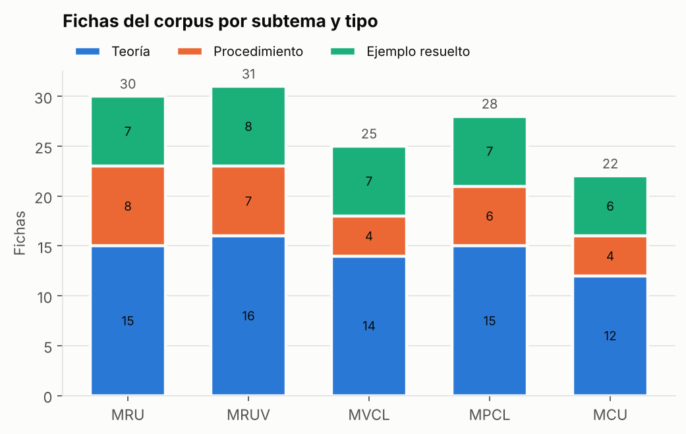
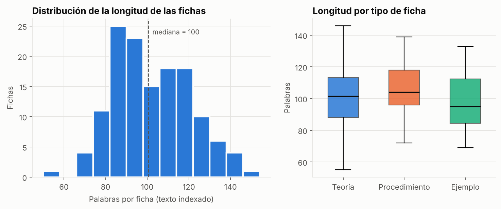
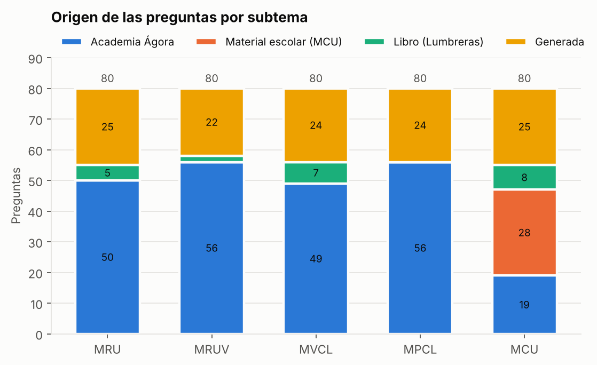
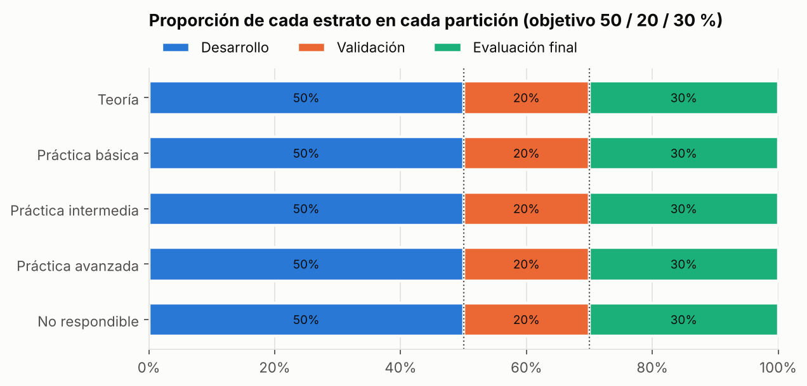
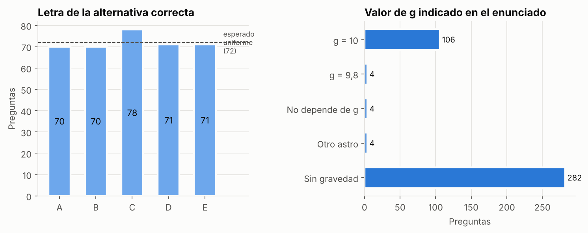
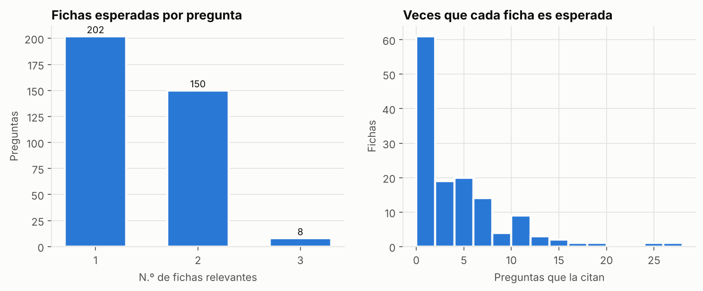
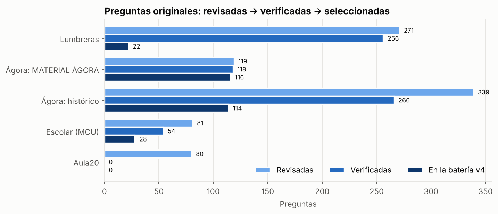

# Análisis exploratorio de datos (EDA) — resumen

**Proyecto:** chatbot educativo de cinemática basado en LLM + RAG (MIA-UNI)
**Autor:** Elmer Dante Rojas Zuta
**Notebook completo:** [`notebooks/01_eda.ipynb`](../../notebooks/01_eda.ipynb)

## 1. Qué datos se analizan y por qué

En esta etapa el proyecto tiene dos conjuntos de datos. Todavía no hay datos de estudiantes; llegarán en el estudio educativo.

| Conjunto | Contenido | Función en la tesis |
|---|---|---|
| **Corpus v5.1** | 136 fichas de teoría, procedimientos y ejemplos resueltos | Base de conocimiento que el chatbot **consulta** (RAG) |
| **Batería v4** | 400 preguntas con clave, solución de referencia y fichas esperadas | **Examen** con el que se evalúa al chatbot |

El EDA verifica que ambos sean adecuados **antes** del experimento. Un corpus con vacíos o una batería desbalanceada harían engañosos todos los resultados posteriores.

## 2. Resultados principales

### Corpus



- **Cobertura:** las 136 fichas cubren los cinco subtemas, con entre 22 (MCU) y 31 (MRUV) fichas cada uno. El 53 % son de teoría, el 21 % procedimientos y el 26 % ejemplos resueltos.
- **Contenido:** todas citan su fuente (síntesis propias basadas en Lumbreras y Giancoli). Las de teoría y procedimiento incluyen sus ecuaciones y los errores frecuentes del alumno.



- **Longitud homogénea:** de 55 a 146 palabras, con mediana de 100; equivale a unos 90–235 tokens estimados.
- **Consecuencia:** cada ficha es una unidad semántica completa y se usa **como fragmento del RAG sin volver a partirla**. Con k = 5, el contexto ocupa unos 800–1200 tokens.

### Batería

| | Teoría | Práctica básica | Práctica intermedia | Práctica avanzada | No respondible | Total |
|---|---|---|---|---|---|---|
| Cada subtema | 18 | 18 | 18 | 18 | 8 | 80 |
| **Total** | 90 | 90 | 90 | 90 | 40 | **400** |



- **Origen:** el **70 % es material real** (280 preguntas): 230 de la academia Ágora, 28 de material escolar de MCU adaptado y 22 de Lumbreras. **Toda la práctica es original.**
- **Generadas (120):**
  - 81 de teoría, porque el material de la academia casi no trae preguntas conceptuales;
  - 39 no respondibles, que tienen que inventarse (una de las 40 es real).

  Están pendientes de revisión docente.



- **Partición exacta:** 200 / 80 / 120. Cada subtema aporta 40/16/24 y cada estrato se reparte exactamente 50/20/30 %. Las 5 familias de preguntas parecidas quedan enteras en un mismo conjunto.
- **Corrección hecha durante el EDA:** la primera asignación dejaba solo 6 preguntas no respondibles en validación, el conjunto con el que se calibra el umbral de abstención. Se corrigió con 4 intercambios dentro del mismo subtema.



- **Posición de la clave:** está distribuida casi por igual entre A y E (70–78 preguntas por letra; χ², p = 0,96).
- **Valor de g:** toda pregunta cuya respuesta depende de g lo indica en el enunciado: 106 usan g = 10 m/s² y 4 usan g = 9,8 m/s².

### Relación entre la batería y el corpus



- **Estándar de oro:** las 360 preguntas respondibles tienen anotadas entre 1 y 3 fichas esperadas. Este es el estándar para calcular Recall@k y MRR. No hay referencias rotas.
- **Fichas sin uso:** 47 fichas no son citadas por ninguna pregunta; 35 de ellas son ejemplos resueltos, que aportan contexto pero no son el objetivo de la recuperación.
- **Cobertura parcial:** **11 preguntas** piden conocimientos sin una ficha específica (sombras, cinemática vectorial, x(t), rumbos). Esto define las fichas nuevas del corpus v6.
- **Sin filtración:** ninguna pregunta está copiada en el corpus. 17 comparten estructura con algún ejemplo, pero con datos distintos, y quedan marcadas para analizarlas por separado.

### Origen y selección



- **Banco revisado:** 890 preguntas originales = 694 verificadas + 196 no verificadas. Las cifras cuadran fila por fila en `data/eda/inventario_fuentes.csv`.
- **Verificadas:** 694, todas con su clave confirmada por el docente, impresa en el libro o cotejada con el libro físico.
- **No verificadas:** 196, que no pasaron a la verificación: repetidas, defectuosas, fuera de alcance o de una academia que Ágora no usa.
- **Seleccionadas:** 280 de las verificadas, estratificadas, con prioridad para el material de Ágora. Las demás verificadas quedan como reserva, salvo algunas del material histórico que se retiraron después de verificarlas (repetidas, anuladas u omitidas), con su motivo registrado.
- **Trazabilidad:** cada pregunta tiene su fuente exacta, y cada modificación (121 en total) tiene su motivo registrado en `data/bateria/registro_verificacion.csv`.

## 3. Decisiones derivadas del EDA

1. **Fragmentación del RAG:** una ficha = un fragmento. Se empieza con **k = 5** y se ajusta con la partición de validación.
2. **Corpus v6:**
   - 4–5 fichas nuevas de teoría: sombras, cinemática vectorial, x(t), velocidad relativa en 2D y plano inclinado;
   - unos 120 ejemplos resueltos tomados de la reserva de preguntas verificadas, sin repetir ninguna variante de la batería.
3. **Prompt del sistema:** «usa siempre el valor de g que indique el problema».
4. **Evaluación:** reportar los resultados también por origen, nivel, cobertura parcial y similitud con el corpus.

## 4. Limitaciones

- **Preguntas generadas:** la teoría y las no respondibles son, en su mayoría, generadas, y están pendientes de revisión docente.
- **MCU:** depende en parte de material escolar externo adaptado al formato de la academia.
- **Corpus:** pendiente de validación por expertos independientes.
- **Tokens:** son estimaciones (1,6 tokens por palabra); el conteo exacto depende del modelo.
- **Textos no publicados:** las preguntas de libros con derechos de autor (50) se publican con su referencia exacta y sus métricas, pero sin el enunciado.

## 5. Reproducibilidad

```bash
pip install -r requirements.txt
jupyter nbconvert --to notebook --execute notebooks/01_eda.ipynb
```

El notebook usa solo archivos publicados en `data/`. Las tablas se guardan en `results/eda/tablas/` y las figuras en `results/eda/figuras/`.
